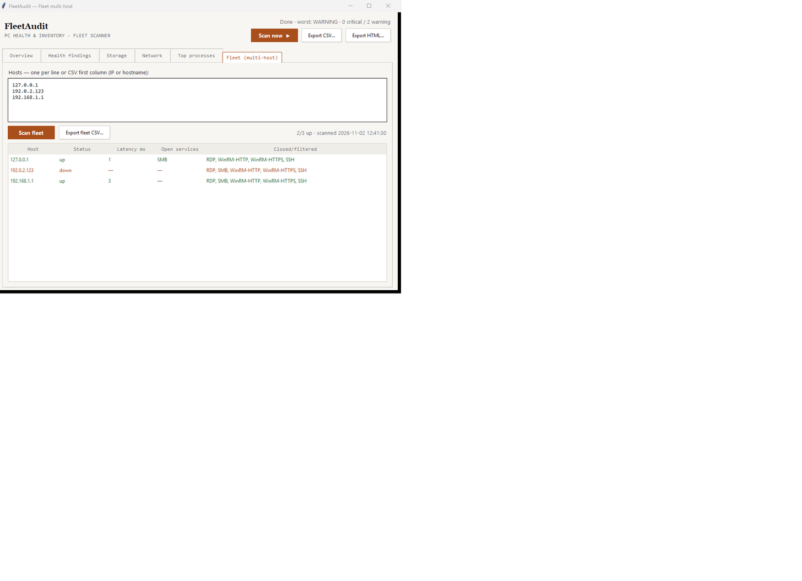

# FleetAudit Desktop



A desktop app for junior IT support work: one-click health audit and
inventory of a Windows PC, multi-host fleet reachability scanning, scan
history with diff — all exportable. Single executable, no install needed.

Built with **Python 3.10+, Tkinter/ttk, psutil** — zero heavy dependencies.
UI follows the same Editorial Light design language as
[my portfolio](https://taufiqnasrullah195.github.io/taufiq-portfolio/).

## What it does

- **Overview** — hostname, OS build, CPU/memory, boot time and uptime
- **Health findings** — threshold engine flags:
  - CPU ≥ 85% sustained → WARNING
  - RAM ≥ 85% → WARNING
  - any disk < 10% free → CRITICAL
  - uptime > 7 days → WARNING (reboot/patch overdue)
  - single process ≥ 25% RAM → WARNING
- **Storage** — per-partition total/used/free
- **Network** — interfaces, IPv4, link state/speed
- **Top processes** — top 10 by memory
- **Fleet (multi-host)** — paste a host list (one per line or CSV first
  column), then batch ping + TCP probes for the ports a helpdesk checks
  first: RDP (3389), SMB (445), WinRM (5985/5986), SSH (22). Status, latency
  and open/closed services land in one table with live progress
  (`Scanning… 3/10 hosts`), exportable to CSV
- **History** — every scan is persisted to SQLite
  (`%LOCALAPPDATA%/FleetAudit/fleetaudit.db`) and survives restarts; each
  new run diffs against the previous one and reports NEW / RESOLVED findings
- **Export** — HTML report (styled, severity-colored) + CSV row
- **Probe isolation** — a failing counter (e.g. unreadable disk) is recorded,
  never crashes the audit run

## Download

Grab `FleetAudit.exe` from the latest
[GitHub Release](https://github.com/taufiqnasrullah195/fleetaudit-desktop/releases)
— a single file, runs on Windows 10/11 without Python installed.

> First launch: Windows SmartScreen will warn once (unsigned binary).
> Click **More info → Run anyway**.

## Run from source

```
pip install psutil
python app.py              # interactive
python app.py --selftest   # headless: auto-scan, auto-close, exit 0
python run_tests.py        # full pytest suite
```

Build the executable yourself:

```
pip install pyinstaller psutil pillow
python make_icon.py        # regenerates assets/icon.ico
python build_exe.py        # → dist/FleetAudit.exe
```

## Layout

- `fleet_core.py` — pure collection + threshold + export logic (no Tkinter)
- `fleet_multi.py` — multi-host ping + service-port probe layer
  (ThreadPoolExecutor, 16 workers, locale-tolerant ping parsing keyed on the
  TTL invariant — a successful reply always carries TTL, in every locale,
  while "Destination net unreachable" replies never do)
- `fleet_store.py` — SQLite persistence: scan history, fleet history,
  diff-vs-previous-run
- `app.py` — GUI; scans run in daemon threads, results cross to the UI via
  a queue drained on the Tk main loop (`after()`), so the window never
  freezes during CPU sampling
- `test_fleet_core.py`, `test_fleet_multi.py`, `test_fleet_store.py` —
  36 unit + live-probe tests (live tests target localhost and TEST-NET
  addresses; the LAN gateway test is skip-safe)

## Verified

- `run_tests.py` → 36 passed
- `app.py --selftest` → local audit + 2-host fleet scan rendered, exit 0
- persistence: two audits across separate processes → history grows,
  DB survives restart
- live LAN check: router 192.168.1.1 up (1 ms), all helpdesk ports correctly
  reported closed; localhost SMB (445) correctly reported open

## Next steps (roadmap)

- WinRM/SSH inventory pull (remote hostname, OS, RAM — not just reachability)
- Email digest of findings

## License

[MIT](LICENSE)
